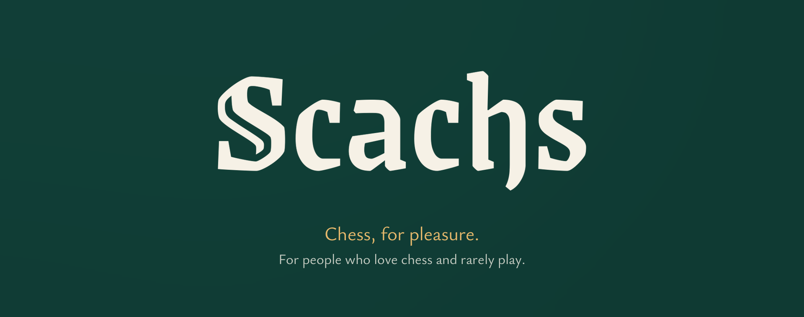
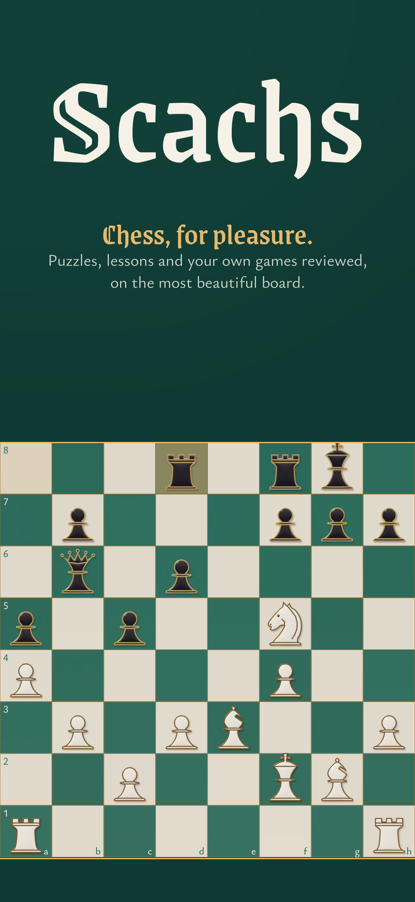
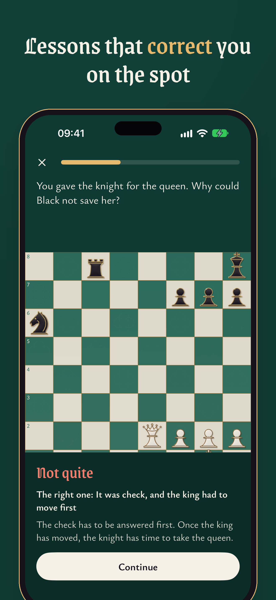
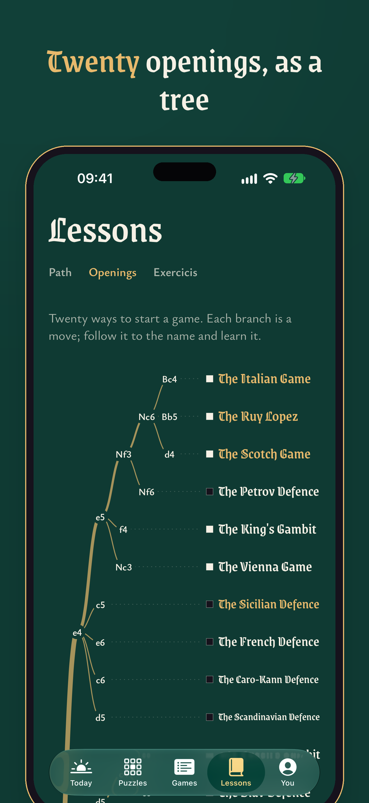
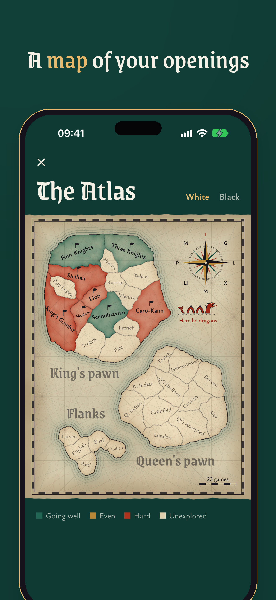
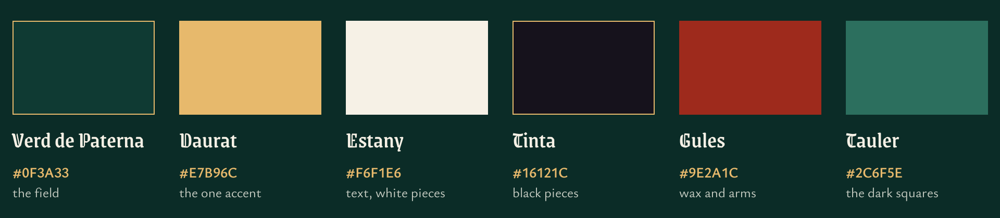

<p align="center">
  
</p>

<p align="center">
  
</p>

<p align="center">
  <a href="COPYING.md"></a>
  
  
  
</p>

<br>

You have ten minutes, on the sofa, at eleven at night. Scachs gives you a beautiful board and a problem your size, and then leaves you alone. A native iOS app with enamel pieces that catch real light as you tilt the phone, and Stockfish running on the device, with no accounts and no servers.

<p align="center">
  
  
  
  
</p>

## What's in it

**Today.** A moment from your last game, every day: find the move you missed, then hear why. The daily puzzle sits underneath, with a streak that a day off doesn't break.

**Puzzles.** A hundred thousand positions from real games, chosen to your strength. The ones you miss come back later, with no counter of debts.

**Your games.** Bring them from chess.com or Lichess with just your username, or paste a PGN. Stockfish reviews them on your iPhone, offline: accuracy, an evaluation graph, and every move labelled in the notation you already know, with the reason.

**Lessons.** A winding road of short lessons, each sealed in red wax when you finish it, from *the golden rules* for someone starting out, through tactics, mating nets, endgames and middlegame strategy, to *Mastery*: candidate moves, the exchange sacrifice, zugzwang, defending bad positions. Quick questions, a panel that tells you why, and anything you miss comes back before the end.

**Openings.** Twenty openings drawn as a tree that grows from the first move, ten with each colour, from the Italian to the Grünfeld. Follow a branch to its name, then learn the line by playing it from memory, its plans and the trap to avoid.

**Exercises.** Practice by theme, every chapter shown by one of its own positions: pawn, rook and minor-piece endings, attacks on either wing, every tactic and every named mate. The set follows your rating, so it serves a beginner and a strong player alike.

**The Atlas.** Your openings as a medieval portolan chart: the ground where you do well, the ground that costs you, and dragons where you keep losing.

**Your arms.** Scachs reads your games and tells you which medieval figure you are, the Knight, the Castellan, the Pilgrim, with a shield in enamel and gold to match.

**No noise.** No accounts, no ads, no leagues. Come back after three weeks and the board is where you left it.

## The look

<p align="center">
  
</p>

One green field carries every screen, the copper green of fourteenth-century Valencian ceramics. Gold is the only accent, and only for what you can touch. Titles are set in Grenze Gotisch and everything else in Ysabeau Office. The pieces are enamel held in a gold wire, drawn in code in `brand/pieces`. [`brand/BRAND.md`](brand/BRAND.md) is the guide and [`DESIGN.md`](DESIGN.md) holds the rules.

## The name

*Scachs* is the word in the poem *Scachs d'amor* (Valencia, c.1475), the earliest known record of the modern queen and bishop. Say "skaks". The known manuscript was a copy, and today nobody knows where it is.

## Build

Needs Xcode 27 and [XcodeGen](https://github.com/yonaskolb/XcodeGen).

```bash
scripts/setup.sh
```

Then open `Scachs.xcodeproj`. The Stockfish target always builds optimised.

## Layout

- `Scachs/`: the app. [`docs/ARCHITECTURE.md`](docs/ARCHITECTURE.md) has the map.
- `Engine/`: Stockfish 19 and the C bridge.
- `brand/`: identity, tokens, and the code that draws the pieces, the logo and the icon.
- `tools/`: reproducible data builds (puzzles, openings, lessons), the lesson checkers and the label calibration ([`docs/CALIBRATION.md`](docs/CALIBRATION.md)).
- `AppStore/`: store text, screenshots, privacy policy and [`SUBMIT.md`](AppStore/SUBMIT.md). `scripts/testflight.sh` archives and uploads.

## Licence

GPL-3.0-or-later. Stockfish is GPLv3. See [COPYING.md](COPYING.md) for what's under which licence, including the name and logo. Puzzles and opening names come from the Lichess database (CC0). The fonts are under the SIL Open Font License.

Not affiliated with chess.com or Lichess. Move labels are computed by this app with its own model and may differ from other services.
